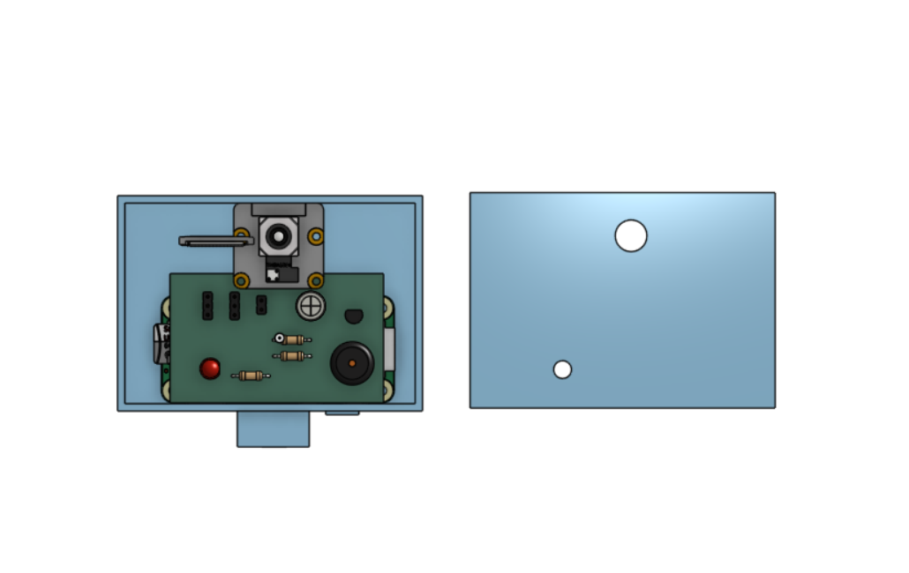

# Antiprock: универсальный трекер камер
Это трекер-камера, которая отсчитывает, сколько вы действительно учитесь, без отвлекающих факторов
1. We have developed a camera-equipped stand along with a companion app. Here’s how it works: you place the stand in front of your desk while you are studying or working. You don’t need to do anything else—simply activate it via the app, and the camera will automatically begin tracking your movements. The app allows you to turn the camera on or off, as well as manage which applications are permitted for use during your study sessions. Since the camera and the app are connected via Wi-Fi, the camera can provide alerts—signaled by a red light—triggered by commands from the app.
2. Concentration directly impacts the quality and speed of learning; maintaining focus ensures academic success and helps you make steady progress in whatever you are studying or undertaking. In short, this system is designed to help people avoid external distractions, enabling them to complete their work consistently and to a high standard. It will be especially beneficial for individuals with ADHD who are motivated to learn, though it is equally useful for anyone else—after all, getting distracted is a common challenge that can affect anyone. We created this camera-equipped stand to provide real value to people and help address this widespread issue.

